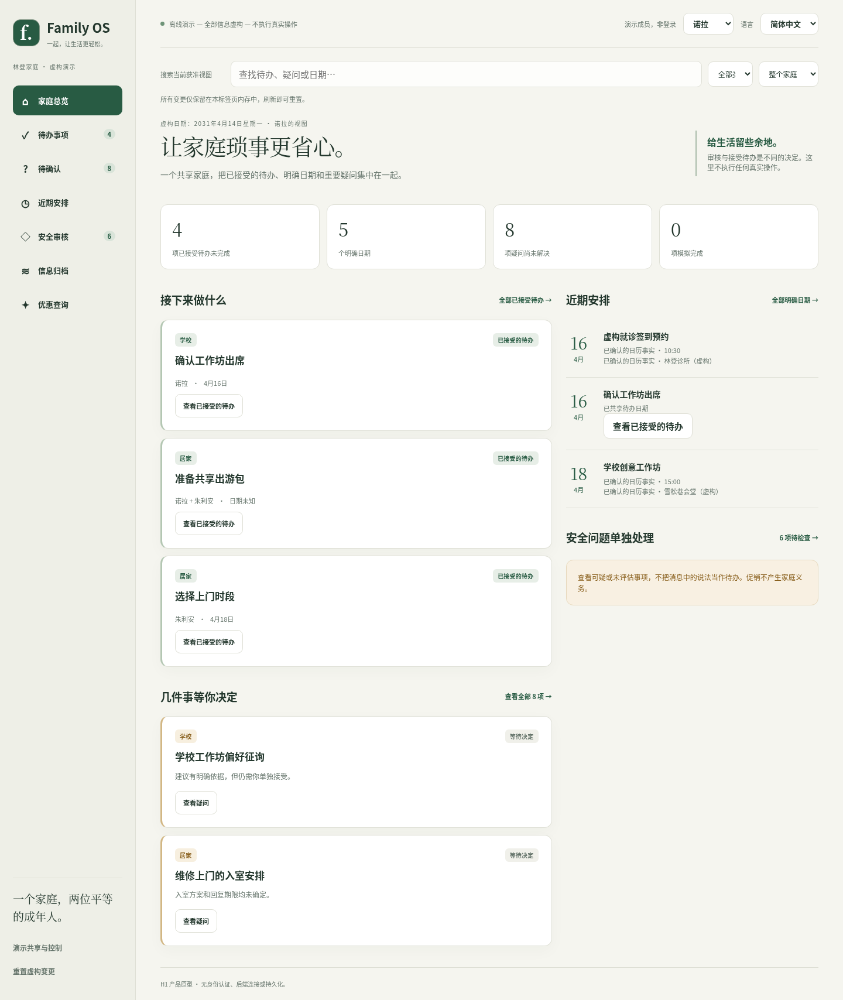
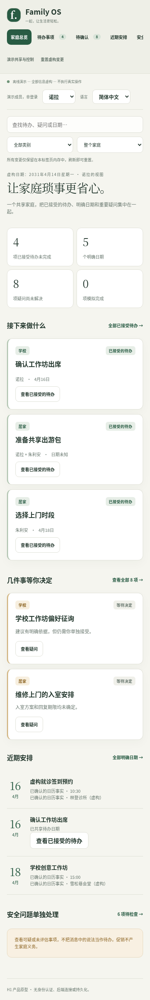
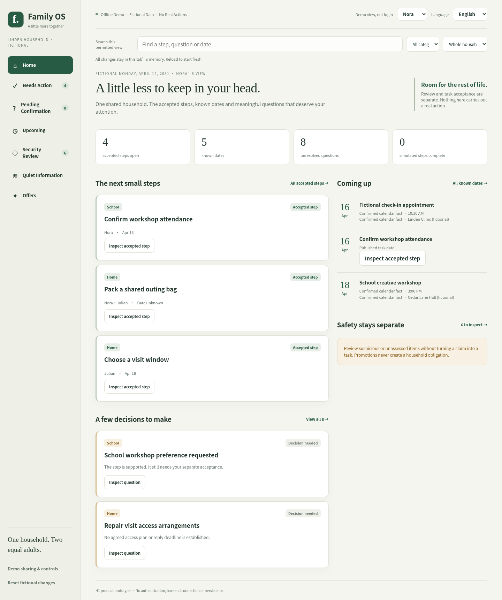
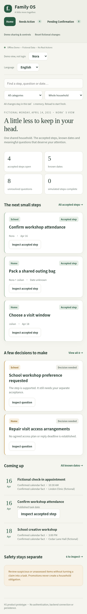

# Stage H1 — 中文优先的双语离线家庭工作台

同一入口现由 [UX1](v0-1-unified-household-ux.md) 更新导航、视觉与交互文案，并增加
独立确认的虚构任务分工。以下记录 H1 阶段的历史范围与验证；当前截图、交互说明
及 Windows 人工门槛请以 UX1 指南为准。双语机制和来源/发布权限边界保留。

H1 只为 H0 的虚构离线原型增加中文和英文呈现，不是生产客户端、登录系统
或真实数据集成。默认语言是简体中文（`zh-CN`），可切换为 English（`en-US`）。
所有信息虚构，所有变更只在本标签页内存中，不执行任何真实操作。

## Windows 本地打开 / Open locally

从仓库根目录执行以下 PowerShell 命令，或双击同一文件：

```powershell
Start-Process (Resolve-Path '.\prototypes\h0-workbench\index.html').Path
```

无需 Python、Node、登录、安装、服务器或网络。请将 `index.html`、`styles.css`、
`fixtures.js`、`translations.js`、`i18n.js`、`model.js`、`presentation.js` 和 `app.js`
保持在同一目录。使用支持原生 HTML dialog 和 `structuredClone` 的现代浏览器。
如果机构策略禁止打开本地文件，不要绕过策略或上传到公共托管服务。

From the repository root, use the same command or double-click the HTML file.
Keep all eight local assets together. No server, account, package install or internet
is needed. Choose **English** beside the fictional member selector for English.
The selector is not authentication. Reload resets the fictional state and both
members' language preferences to Chinese. Separate tabs/devices do not synchronize.

## 语言与业务状态 / Language and state

诺拉（Nora）和朱利安（Julian）各自保留一个内存中的语言偏好。切换成员会恢复
该成员的偏好，双方仍使用同一个虚构家庭状态，没有两个待办数据库。
语言选择不会增加权限、改变安全评估、接受/完成待办或产生审核历史。

语言只有一个入口：桌面顶部，手机“更多”。打开详情/确认时，先返回、取消或 Esc
关闭弹窗，再从全局入口切换，需要时重新打开详情；始终基于当前权限呈现。
全局语言处理仍有防御性保护：若收到语言变更事件，**任何尚未确认的草稿（包括
重置确认）均取消**，不会重新绑定或提交旧决定。需重新检查并明确确认。搜索词会清空、分页回到第一页，避免把旧语言
中的搜索误当作新语言查询；类别和负责人仍使用稳定业务值。

Each peer has an independent in-memory preference. The single global picker is in
the desktop header or mobile More menu. Dismiss details or cancel an unfinished
confirmation before switching, then reopen details under fresh access checks if
needed. The global handler also defensively cancels any unfinished draft if a
language-change event arrives; it never submits or rebinds that decision, including
reset confirmation. Localized live feedback remains explicit. Search text/page reset
is presentation state only; source permissions, household decisions and audit remain
unchanged. Reset/reload clears both preferences to `zh-CN`.

## 简短双语操作演示 / Bilingual walkthrough

| 中文操作（默认） | English equivalent | 应观察的结果 / Expected outcome |
| --- | --- | --- |
| 家庭总览；在诺拉与朱利安之间切换 | Home; switch Nora/Julian | 共享状态一致，各自的私有来源内容不出现在对方视图。Shared state, separately permitted private views. |
| 待确认 → 学校工作坊偏好征询 → 记录已审阅（不创建待办） → 确认记录已审阅（仅演示） | Pending Confirmation → School workshop preference requested → Record simulated review only → Confirm simulated review only | 仍在待确认，不产生待办。Review is not acceptance. |
| 再次查看 → 加入待办… → 确认加入待办（仅演示） | Inspect again → Accept suggested step… → Confirm simulated task acceptance | “提交工作坊偏好 / Send a workshop preference”进入双方待办；不发送回复。 |
| 维修上门的入室安排 → 稍后再处理… → 确认稍后处理（仅演示） | Repair visit access arrangements → Defer question… → Confirm deferral | 问题仍未解决，继续保留在可分页的完整积压中。No dismissal/deadline inferred. |
| 安全审核 → 未经核实的邮箱登录请求 | Security Review → Unverified mailbox sign-in request | 地址是不可点击文字，无法接受为登录或付款待办；审核不会解除风险。 |
| 优惠查询 → 查询虚构优惠 | Offers → Find fictional offers | 主动查询之前不显示优惠；虚构优惠码保持原样，资格未知/未经核实，过期不产生提醒。 |
| 待办事项搜索“出游包”；英文视图搜索“outing bag” | Search the corresponding displayed-language task words | 找到同一获准任务；不查询隐藏证据或另一种语言的源文本。 |
| 诺拉 → 演示共享与控制 → 林登家庭通知 → 撤销朱利安的演示读取权限 → 确认 | Nora → Demo sharing & controls → Linden household notices → Revoke Julian's demo read access → Confirm | 朱利安的相关来源详情、搜索和计数消失；已独立共享的中性待办字段继续可见，无私有证据。 |
| 取消/Escape 退出接受确认，再通过全局入口切换语言 | Cancel/Escape the acceptance confirmation, then use the global language entry | 草稿取消，未接受待办；必须重新开始确认。 |
| 模拟完成 → 确认模拟进度变更 | Simulate completion → Confirm simulated tracking change | 仅更新演示进度，语言切换不改变已接受待办或历史。 |
| 刷新或确认重置演示 | Reload or confirm demo reset | 恢复虚构初始状态和双方默认中文偏好，没有写入浏览器存储。 |

## 本地 i18n 结构与证据边界

- `translations.js` 是集中、人工编写的 279 项中英文文案对。采用显式键，保留原有
  H0 案例的意义；不使用在线翻译、运行时 AI 或任意英文子串替换。
- `i18n.js` 验证重复键、缺失/无效值、占位符名称及重复次数一致性；未知键/语言、
  多余或缺失参数、非法插值都拒绝。插值结果是纯文字，最终仅用 `textContent`。
- `presentation.js` 先取得未改动 H0 模型的获准 DTO，再按稳定 ID 翻译显示字段。
  搜索只针对当前语言的获准标题、步骤、摘要、商家及类别显示文字。先收集获准的
  有限待确认页，再翻译、筛选并按原每页 3 项分页；不复制路由或授权策略。
- 业务 ID、枚举、权限、版本、日期和优惠码不翻译。原始英文虚构案例保留在
  `fixtures.js`，中文呈现与原始案例分离；语言切换不写入或增强来源证据。
  H0 的安全、业务分流和接受权限语义保持不变。
- 日期/时间/计数使用相应的 `Intl` locale，时间以明确的 UTC 格式化避免机器时区
  移动示例日期。继续使用固定虚构日期 **2031-04-14**，不读取机器当前日期来推断义务。
- Future original source content, translated presentation and derived summaries are
  separate artifacts. Future translation artifacts need exact source-snapshot and
  translation-definition binding. A translation must not replace source evidence or strengthen
  an unsupported obligation; no future real-data translation engine is authorized here.

中国用户看到完整中文案例、状态、说明、历史、确认及无障碍标签。Family OS、
English 选项、虚构商家专名、不可点击示例域名、优惠码与技术标识有意保留。
系统字体支持中文，不加载字体文件。窄屏导航可横向滚动并可通过键盘逐项进入。

## 验证 / Validation

开发检查（使用已有开发环境，不是打开演示的前置要求）：

```powershell
node .\tests\browser\h0-model.test.js
node .\tests\browser\h1-i18n.test.js
.\.venv\Scripts\python.exe -m pytest -q tests/test_h0_workbench.py tests/test_h1_workbench.py
.\.venv\Scripts\python.exe -m pytest -q
.\.venv\Scripts\python.exe -m pip check
git diff --check
```

Node >=18 仅用于开发测试。已有两项 SQLite/PostgreSQL CI 通过 Python 包装测试
运行 JS，不新增包管理器、构建链或工作流。浏览器测试使用环境中已安装的
Playwright/Chromium，可运行 `tests/browser/h0-interactions.js` 和
`tests/browser/h1-interactions.js`；不自动安装浏览器，不下载模型，不启动服务器。

已验证：31 项原有 H0 JS 测试、26 项新增双语 JS 测试、13 项相关 Python 测试
（8 项原有 + 5 项新增）、14 项 H0 英文浏览器检查和 17 项双语浏览器检查。
覆盖默认中文、全部视图、独立语言偏好、关闭弹窗后全局切换/取消、显式接受与审核区别、
双语搜索、权限撤销、独立发布、风险状态、历史、日期及 1440/390/320px 布局。
完整 Python SQLite/PostgreSQL CI 的实际结论、总数和准确 HEAD 在 PR 中记录。

浏览器使用 Chromium 151，将本地文件内容注入离线 `about:blank`，阻止所有请求；
无网络请求和运行错误。该注入测试绕过 CSP，不证明本地入口/CSP 已端到端通过。
本阶段再次直接尝试 `file://`，环境策略仍返回 `ERR_BLOCKED_BY_ADMINISTRATOR`。
**Windows 本地直接打开及 CSP 实际执行仍是人工合并前验证门槛**；没有声称验证过
真实手机、全套辅助技术或完整无障碍符合性。

### 仅含虚构数据的截图









## 既有评审提醒与后续限制

- H0 演示的来源读取者列表不能作为生产授权范例：生产客户端只能在专门获准时
  获取完整读取者列表；普通来源读取不隐含这一管理权限。
- H0 事项历史当前对获准读取该事项的成员共享。生产历史的字段/事件可见性需要
  明确的独立策略，而不是靠客户端隐藏。
- 窄屏导航的滚动发现性、重要安全提醒与普通未评估促销的展示区分仍需后续 UX
  讨论；H1 不改变现有安全优先级或引入生产提醒。

所有虚构数据仍随静态文件交付，可在开发者工具中看到。成员选择不是身份认证，
界面演示不是对恶意浏览器用户的保密边界。禁止替换为真实家庭数据。
没有数据库、真实认证/会话、后端 API、持久化、提供商/OAuth、AI、本地 Ollama、
任务执行、隔离/恢复或通知。G2a/G2b1/G2b2 以及提供商、分类器和迁移保持不变。
真实 OIDC code-flow/PKCE、MFA/邀请/恢复、经认证只读 API、响应/撤权/缓存、部署
与独立安全审查仍是后续单独批准的门槛。H1 不批准任何真实家庭信息进入 AI。

Review questions: Are Chinese obligations and uncertainty equivalent to the English
fiction? Is cancel-on-language-change clear enough? Can both peers find permitted
items without private evidence influencing search? Can reviewers verify direct
Windows opening offline and both locales' keyboard/narrow-screen behavior?

PR must remain open/unmerged for ChatGPT independent review, Muse security review and
final human-controlled merge. No auto-merge or hosting is authorized.

### H1 中文文案优化

本轮逐条优化 40 项高频中文显示文案，英文、键和占位符保持不变。
统一“已加入待办”“已审阅”“稍后处理”和风险未知的表达；其余文案已检查安全含义，
保留原有案例、数据和权限语义，没有重译整份词典。
“当前评估未发现风险”不是安全保证；“已审阅”不代表风险解除或加入待办。
加入待办仍需单独确认，且不发送消息或执行事项。已共享的待办信息不开放私人来源。
截图记录首次 H1 呈现，可能保留优化前的字样；本轮不改变布局或重拍历史截图。
