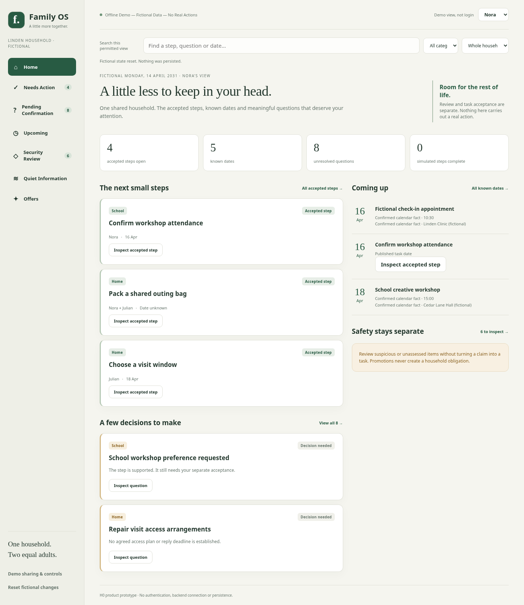
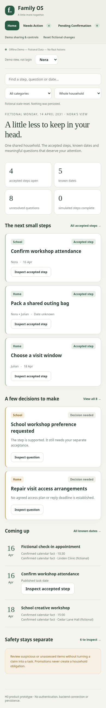

# Stage H0 — Offline fictional family workbench

H0 is a disposable product prototype for one household with two peer adults. It
opens from local HTML and keeps all changes in one browser tab's memory. It helps
review the action-first experience before choosing or exposing a production Web
client. It does not call G2a/G2b1/G2b2, create backend tasks or establish identity.

## Open locally on Windows

From the repository root, in PowerShell:

```powershell
Start-Process (Resolve-Path '.\prototypes\h0-workbench\index.html').Path
```

Alternatively, double-click `prototypes/h0-workbench/index.html`. Keep `index.html`,
`styles.css`, `fixtures.js`, `translations.js`, `i18n.js`, `model.js`,
`presentation.js` and `app.js` together. Use a current browser
supporting native HTML dialogs and `structuredClone` (modern Edge/Chrome/Firefox).
No Python, Node, package install, account, database, server or internet connection
is required to use it. Disconnecting the network is fine. If an organization's
browser policy blocks local HTML/scripts, use an approved personal local browser;
do not bypass that policy or upload these files to a hosting service.

Reloading restores the initial fictional state. **Reset fictional changes** offers
an explicitly confirmed reset without reload. Separate tabs do not synchronize.
For a mobile-sized preview on a desktop, use the browser's responsive viewport.
Opening files on an actual phone depends on its local-file handling and has not
been verified; no mobile hosting or server is supplied.

## H1 bilingual presentation follow-up

Fresh opening now defaults to Simplified Chinese; choose **English** to follow the
original English walkthrough below. Both fictional peers have independent in-memory
language preferences. An unfinished confirmation is canceled on language change,
never auto-submitted. See the [Chinese/English run guide and current validation](v0-1-bilingual-offline-workbench.md).
H0 results/screenshots below record the original stage, not a claim that today's
Windows file-opening has been verified.

## Experience and authored fiction

The invented Linden household contains Nora and Julian, five sources, twenty
source items, five separately accepted tasks and three known calendar facts. The
fixed fictional date is 14 April 2031, not the machine's date. Cases, merchants,
coupons and names were authored only for H0; no private data or frozen evaluation
corpus is loaded. Category badges are display labels, not changed classifier rules.

| View | Admission and interactions |
| --- | --- |
| Home | Open accepted steps, known dates, two preview questions and permitted full-backlog counts; separate security indication. No advertising feed. |
| Needs Action | Independently accepted fictional tasks only. Assignee filters operate on the same household state. Completion/reopening updates simulated tracking after confirmation. |
| Pending Confirmation | Important supported suggestions or unresolved service questions. Three per page, authorized total and Previous/Next. Defer and needs-information retain unresolved entries. Unknown important questions remain discoverable but cannot be accepted. |
| Upcoming | Explicit calendar facts and published accepted-task dates, labelled separately. Unknown dates and offer expiry never become deadlines. |
| Security Review | Suspicious, high-risk and unknown/stale safety, including an important legitimate-notice false-positive stress case. Inspect inert text and record a review annotation; no payment/login links, safety clearance, quarantine or restore. |
| Quiet Information | Harmless authored information without an inferred obligation. |
| Offers | Results only after **Find fictional offers**. Coupons/expiry are fictional; eligibility remains unknown/unverified. Suspicious or unknown promotions never enter Offers. |

Search and category filtering use currently permitted display fields only.
Assignment filtering supports the entire household or steps assigned to the selected
member/both. Search input is displayed as text, never executed as HTML. On narrow
screens, navigation scrolls horizontally; swipe the navigation or tab through its
buttons to reach every view. Controls and dialogs remain keyboard-operable.

Ordinary promotions, including expired promotions, do not enter Pending or Needs
Action and create no attention alert. A promotion with missing safety remains
inspectable in Security Review, without becoming a household question or being
cleared as an offer. Security-view counts describe permitted authored safety
concerns; no notification is sent. There is no real phishing detector or evidence
that these fictional assessments reflect real-world performance.

## Independent intentions, versions and visibility

Inspection, navigation, search, filters and closing a dialog do not save decisions.
Each mutation requires its own confirmation: review annotation, task acceptance,
deferral, needs-information, tracking, sharing change or optional evidence probe.
Cancel/Escape discards the draft. Review confirmation is never task acceptance,
never clears security evidence and never demotes a previously accepted step.
Only a fresh CLEAR, supported ACTION with an explicit fictional acceptance grant
can create an in-memory accepted task. Defer is not dismissal or automatic resolution.

Drafts bind to the selected actor, exact record revision, evidence generation and
source permission revision. Changed permission/version rejects a stale draft;
reverting text does not revert generation. An exact confirmed receipt can replay
without duplicating a task/history entry, but current access is still checked.
Synthetic histories append until the explicit reset/reload; there is no durable audit.
An accepted task persists as independent published tracking after evidence changes.
Its detail warns about changed evidence **only if that evidence is currently permitted**;
no new action authority is transferred to the changed snapshot. Tracking never
verifies performance of a real household step.

The demo selector is **not authentication**. Both fictional peers operate on one
in-memory household state; independently shared sources, published neutral task
fields and source-control/review/acceptance grants remain separate. Neither peer
is a default superuser. Current source filtering precedes display search, counts,
page selection and evidence projection. Hidden evidence is omitted without a
withheld-item count or identifier. Source controllers can confirm revocation of
the other peer's fictional read grant. Published neutral task fields remain governed
by their separate grant; publication revocation is tested in the model but has no
UI editor in H0. No provider-operation authority exists.

**This is a UI conformance demonstration, not confidentiality against a hostile
browser user:** every fixture ships in `fixtures.js`, so either person could read
all fiction in Developer Tools. Do not replace it with real data. A production
client must receive only server-authorized projections through a reviewed authenticated
boundary; hiding browser fields is not access control. The prototype neither reads
nor alters the durable backend authorization, identity, sessions or provider records.

## Short repeatable walkthrough

1. Open `index.html` as Nora. Home shows four open accepted steps, five known dates,
   eight pending questions and six security concerns. All are fictional and permitted.
2. Select Julian, then Nora. Shared tasks/events appear in the same workspace while
   each person's private note/question/task remains absent from the other's view.
3. Open Pending, inspect **School workshop preference requested**. Record **simulated
   review only** and confirm: it stays a question. Inspect again, choose **Accept
   suggested step…**, then confirm the separate acceptance. **Send a workshop
   preference** now appears in Needs Action for both peers.
4. Inspect **Repair visit access arrangements**, choose **Defer question…** and
   confirm. It stays unresolved with a Deferred badge. Previous/Next traverses the
   entire permitted backlog; the display cap does not discard anything.
5. In Security Review, inspect **Unverified mailbox sign-in request**. Its destination
   is inert text. Record a simulated review: risk remains high, with no task or
   mailbox operation. Inspect the appointment false-positive stress case as well.
6. Open Offers: no results yet. Choose **Find fictional offers** to reveal three
   quiet fictional coupons, including an expired offer; no task, discount or alert
   results. Navigating away resets the offer-query intent.
7. As Nora, open **Demo sharing & controls**. For **Linden household notices**, choose
   **Revoke Julian's demo read access** and confirm. Switch to Julian: the source's
   questions/security items/search results disappear. Previously approved neutral
   shared tasks remain, with only currently permitted supporting evidence.
8. Optionally, as Nora, change the workshop evidence sample in controls. Its safety
   becomes unknown and new acceptance is unavailable. An earlier task remains
   separately published; Nora can see a changed-evidence warning in its detail.
9. Simulate completion of an accepted step with its separate tracking confirmation;
   switch peers to see the same state. **Show simulated completed steps** reveals it.
10. Reload or confirm Reset to restore fiction. No browser storage or file was written.

## Validation and screenshots

Developer checks, from the repository root:

```powershell
node .\tests\browser\h0-model.test.js
.\.venv\Scripts\python.exe -m pytest -q tests/test_h0_workbench.py
.\.venv\Scripts\python.exe -m pytest -q
.\.venv\Scripts\python.exe -m pip check
git diff --check
```

Node >=18 is a developer-test requirement only. The existing Ubuntu SQLite and
PostgreSQL CI jobs run the JS model through a Python regression wrapper, without
an npm install or workflow change. The optional `tests/browser/h0-interactions.js`
requires an already installed Playwright/Chromium test environment, not the user's
runtime. It performs no browser/model downloads and runs no server.

Verified focused results: **31 JavaScript model tests**, **8 Python H0 tests** and
**14 browser interaction checks**. Browser checks used installed Chromium 151 with
local HTML/CSS/JS content injected into an offline `about:blank` context, all
requests intercepted and aborted. The test harness bypassed CSP only to inject
those local assets. It exercised actual DOM controls/dialogs, keyboard cancellation,
pagination, revocation, search-text safety and responsive layout at 1440, 390 and
320 pixels; no request or browser runtime error occurred. Static tests verify local
asset references, restrictive CSP, safe text construction and absence of network,
storage, import or provider interfaces.

This environment's browser policy blocked direct `file://` navigation; a virtual
origin attempt also could not load. **Direct Windows file-opening and CSP enforcement
have not been verified here**, and the local-content harness does not establish them.
The manual Windows opening check remains a reviewer gate; do not mistake screenshots
for an end-to-end Windows validation. No claim of full accessibility certification
or testing on actual mobile hardware is made.

Full Python SQLite/PostgreSQL test results and exact PR head are recorded in the PR.
The screenshot assets contain only H0 fiction, captured from the described harness:





## Limits, review questions and next separate phase

There is no login, shared backend connection, database, durable task/history, browser
API service, content import, network call, browser storage, model inference, actual
quarantine/restore, notification or provider write. Security assessments and sharing
grants are authored demonstration state, not independently verified authority.
The native HTML entry point has no build chain, externally hosted assets or heavy
UI framework. Two tabs/devices do not synchronize; source publication editing,
real scheduling and all business/provider execution are deliberately absent.

Review questions:

- Does Home feel like shared household coordination rather than a merged inbox?
- Are review, acceptance, tracking and safety inspection distinct enough?
- Are important unknown questions discoverable without advertising noise?
- Is independent neutral task continuity understandable after source revocation,
  without implying access to hidden evidence or a new action approval?
- Does the Windows local entry point work offline in the reviewer's browser, and
  are narrow layout, keyboard focus and dialogs usable by both intended adults?

After product/security review, propose a **separate production-readiness phase**:
select and approve real OIDC authorization-code/PKCE login, MFA/invitation/recovery,
authenticated read-only API over the existing authoritative household state,
server-side projection and response/revocation/cache rules, credential/deployment
hardening and independent security tests. No vendor, framework, hosting or production
rollout is selected here. Those gates must pass before integrating any real household
data; H0 does not relax the prohibition on real household data in AI, including
local Ollama, or authorize standing-consent Alternative B or a real-mail pilot.
