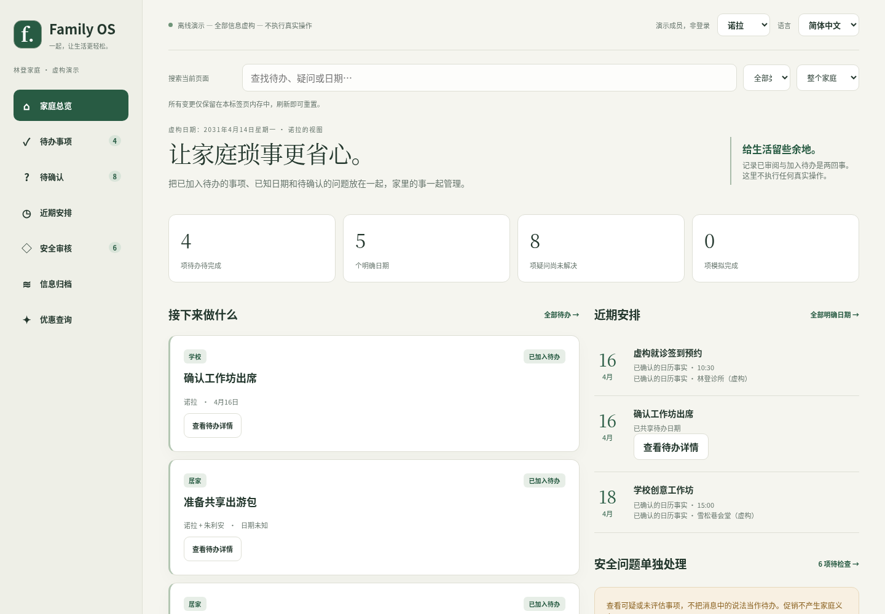
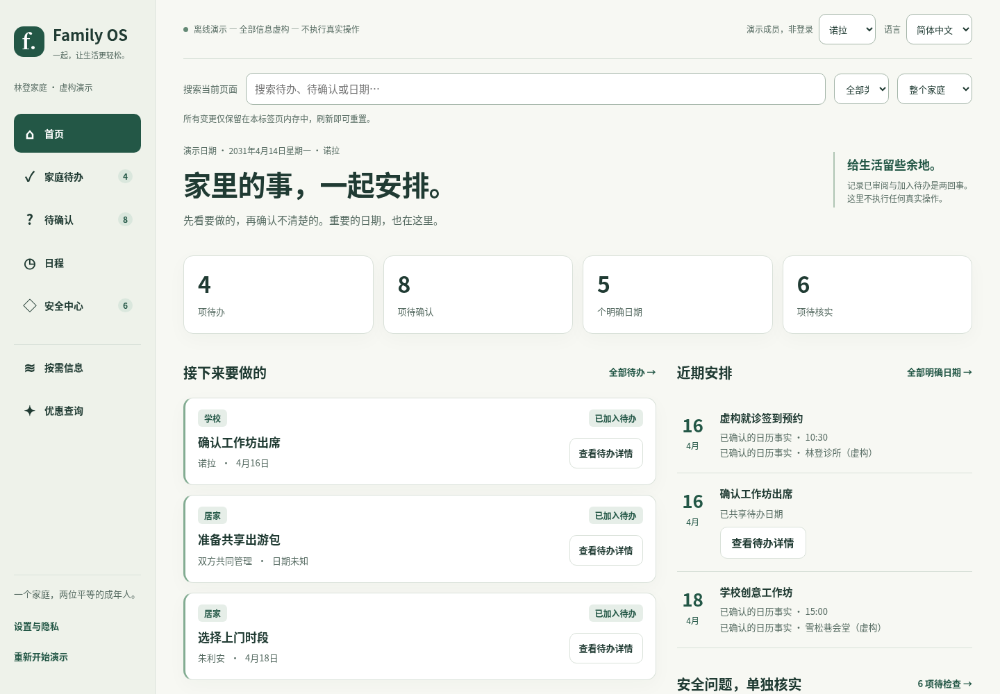
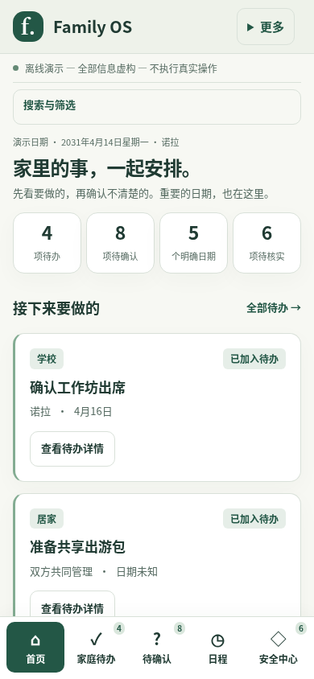
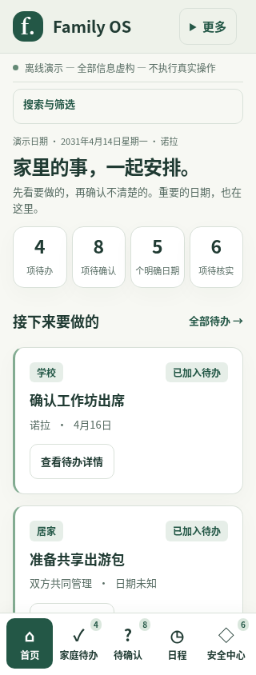
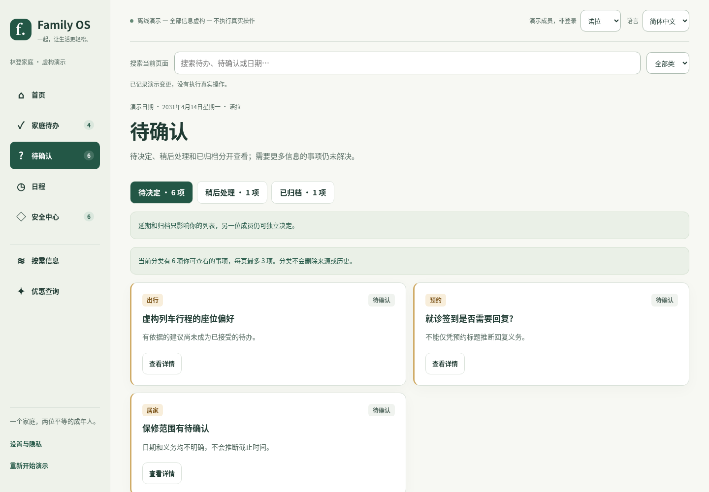
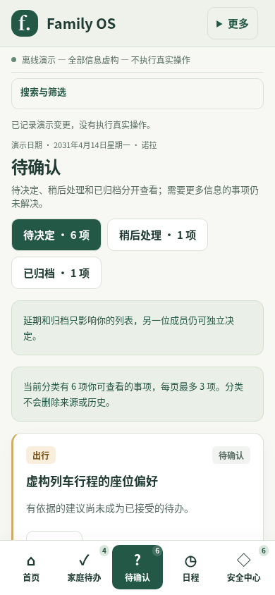
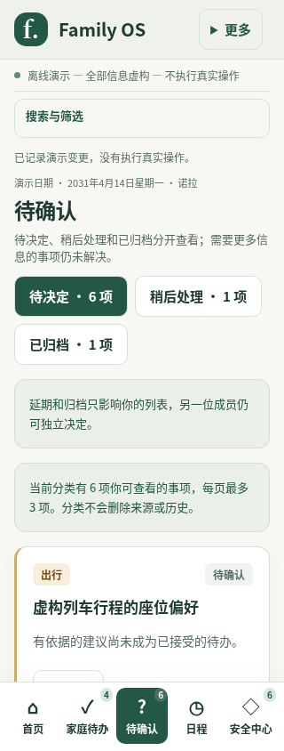
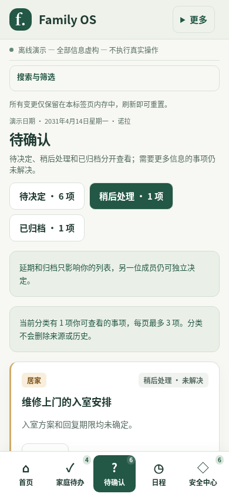
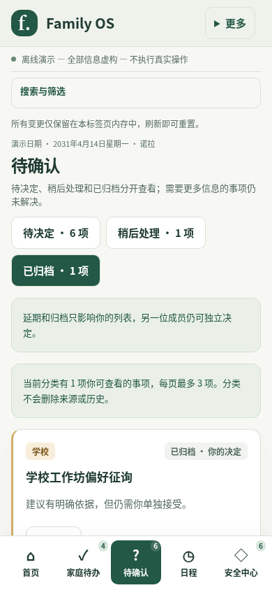

# Samas Family OS — UX1 家庭界面

UX1 是原 H0/H1 家庭应用的中文优先体验改版，入口仍是
`prototypes/h0-workbench/index.html`。没有新建管理网站或另一个任务系统。
全部使用原有林登家庭虚构案例，演示日期固定为 **2031-04-14**，不是设备今天。
没有模型生成、期限推断、真实数据导入或外部操作。

## 产品路线与日常旅程

服务两名平等的成年人：共同管理已明确共享的家事，私人来源仍按来源授权。
成员下拉框只切换虚构视图，不是登录或权限凭据。两位成员操作同一标签页内的
家庭状态；任务不是各自数据库中的副本。刷新重置，不持久化，不跨标签页同步。

| 日常旅程 | 当前可以做什么 | 不表示什么 |
| --- | --- | --- |
| 打开首页 | 看当前可查看的待办、待确认、明确日期、安全事项；点击数量直接进入相应页面 | 不生成 AI 总结，不展示促销或技术监控指标 |
| 查看待确认 | 查看现有摘要和缺失信息；加入家庭待办、稍后处理或无需处理 | 打开不保存；接受单独确认，延期未解决，个人归档不是删除或安全解除 |
| 接受有依据的建议 | 独立确认“加入家庭待办”，双方看到同一共享任务 | 不发消息、不预约、不自动执行建议 |
| 处理任务 | 在详情选择负责人、单独确认分工；标记完成或重新打开 | 进度不是真实世界完成证明；不增加来源权限 |
| 看日程 | 区分日历事实和已接受待办的明确日期 | 不把未知时间、广告有效期或紧急说法当作期限 |
| 查看安全问题 | 只读查看不可点击的虚构风险文本 | 未知不代表安全；没有检测器、隔离、恢复或发件人信任操作 |
| 找信息或优惠 | 次级入口按需查信息；优惠还要明确点击查询按钮 | 不在首页展示广告，不产生促销待办/提醒，不确认用券资格 |
| 设置与隐私 | 查看当前可见来源，来源控制者可单独确认改变虚构共享 | 成员身份不授予来源控制权；连接真实账号按钮明确禁用 |

首页限制展示的任务/问题只是预览，数量和“全部”入口均来自当前授权视图。
待确认每页三项，可翻遍当前分类的完整积压。默认“待决定”包括尚未决定及需要更多信息；延期和个人归档在同页次级分类可找回。
不增加隐含截止日期、自动解决或真实提醒。

## 导航：主流程五项，其余按需

主导航为 **首页、家庭待办、待确认、日程、安全中心**。桌面放在左侧固定可见的
导航栏，移动窄屏使用底部五项导航，减少拇指操作距离。**按需信息、优惠查询**
是次级入口，不占首页内容流；**设置与隐私**放在辅助入口，不另设管理员身份。
日常已共享内容查看无需逐邮件重复授权；真实共享设置、账号接入都不在本阶段。

搜索和类别筛选仅检索当前页面的获准显示字段。负责人筛选是同一家庭待办的
视图过滤，不建立个人任务孤岛。未知/可疑推广只可在安全视图检查，不作为优惠。
页面、详情和设置中的导航不保存；只有明确确认按钮才能改变演示状态。

## 视觉与可访问性

按产品所有者确认，使用白色/浅灰背景、深灰正文与充分留白。深绿只用于主操作与选中强调；
列表使用排版和轻分隔线，去掉侧边色条、容器阴影和装饰图标。风险以明确文字和少量警示标签区分，不依赖颜色。首页突出家事而非
管理台；无配额图表、风险分数、企业租户概念或装饰性 ID。

| 系统 | 选择 |
| --- | --- |
| 字体 | 系统中文字体与 Segoe UI；不下载字体 |
| 正文 / 辅助文字 | 15 / 12–14 px；中文标题 28–40 px |
| 色彩 | 正文 `#252a30`，次级 `#555d67`，少量强调 `#244d42`，背景 `#ffffff` |
| 状态 | 状态文字优先，灰色标签；琥珀/红色仅辅助风险提示 |
| 间距 | 列表 14–18 px，区块间 24–30 px；轻分隔线，控件适度圆角 |
| 控件 | 至少 44 px 高，原生 select/button/dialog，可见键盘焦点 |
| 窄屏 | 单列内容、底部主导航、安全区留白；不水平裁掉页面/对话框 |
| 动效 | 仅短背景过渡，遵守减少动效偏好 |

关键正文/按钮/风险颜色五组以 WCAG AA 4.5:1 对比阈值自动检查。
实际屏幕阅读器和完整可访问性认证尚未验证。无真实异步请求，所以不展示虚构
加载动画或“AI 正在处理”；账号接入以清晰禁用状态说明。空结果提示清除筛选，
未知日期保持未知。错误只提示不可用/信息或权限更新，不公开隐藏来源存在性。

## 中文与英文语义审阅

逐项检查全部 **337** 个双语键及占位符；最终精简新增 27 个键并删除 3 个未使用的口号键，明确反馈、空状态、品牌和详情。
原始案例、业务 ID、日期、优惠码和路由枚举不变。英文同步表达对应语义，
不是简单照搬旧英文词面。主要表达：

- “加入家庭待办”只用于单独接受；取消面向用户的“已审阅”按钮，历史审阅注释绝不冒充归档或接受。
- “稍后处理”移入同页次级分类；“需要更多信息”仍属未解决，保持在待决定中。
- “已完成”/“重新打开”只是演示进度；确认说明保留“不代表付款、预约或回复”。
- “暂时无法确认是否安全”不等于没有风险；当前未发现风险也不是安全保证。
- “双方共同管理”说明中性任务分工，不暗示私人来源自动共享。
- 成功、取消、版本过期、权限不足、空状态、禁用接入、历史与风险说明均保持
  安全含义。优惠过期不产生任务或提醒。没有新增真实通知。

## 复用边界与独立确认

沿用 H1 翻译/授权后呈现和 H0 单一内存模型。为既有任务增加
`task-assignee` 操作：当前编辑者选择当前获准任务接收者或双方，复用同一
prepare/save、revision、当前权限重新检查、取消和幂等 receipt；追加同一任务
历史，不复制任务、不新增生命周期。它不会写 T1 或赋予来源/提供方权限。

选择负责人本身不保存；加入待办、延期、归档、重新打开、分工、进度、共享和重置分别
需要自身确认。确认页的“返回详情”取消草稿并重新读取当前获准详情。
取消/Escape、切换成员/语言不隐式保存。没有通用 Save 按钮授予不相关权限。
静态文件包含全部虚构数据，开发者工具可以看到它们；这不是对恶意浏览器用户的
保密边界。禁止将真实信息替换到 fixtures 或发送到任何模型。

## 将来 T1 → UI 映射（未实现）

| 页面/交互 | T1 对应契约 | 仍需补齐的边界 |
| --- | --- | --- |
| 首页 | 授权后 tasks/pending Page 的 total | 不组合未授权来源计数；真实安全/日程聚合另行批准 |
| 家庭待办 | TaskView 中性 step、assignee、status、approved_date、revision | 不传 pending_id、来源链接、证据数或隐含私人更新警告 |
| 待确认 | PendingView、私有 reviewed/disposition、当前 Binding、capability flags | 能力旗标只指导按钮；后端每次提交重查，不成为客户端权限 |
| 接受 | ACCEPT Command + expected/right/recipient-plan revisions + exact Binding | 独立确认；接受结果 revision 是 Pending revision，新任务从 revision 1 开始 |
| 分工/进度 | EDIT Command，同一任务 + 当前 entity/right revisions | 修改中性跟踪，不获得来源读权限或 R2/R3 操作权 |
| 历史 | T1 独立 history 权限；中性任务历史、仅本人私有审阅 | 当前 H1 历史是内存示例，不等同后端审计或授权证据 |
| 版本/错误 | STALE/CONFLICT/UNAVAILABLE/UNKNOWN/REPLAY | UNKNOWN 不报成功、不盲重试；丢失凭据不能由前端“恢复” |
| 日程/安全/信息/优惠/设置 | 无本阶段新增 T1 接口 | 分别设计认证服务投影、共享控制及部署；不把 H1 模拟权限当权威 |

T1 持久化服务保持未改动、未连接。G3b 不提供本 UI 的任务写入或待确认能力。
H2 是开发者历史响应验证资产，不是用户入口，不复制成管理页面。H1 对已获准
证据变化的提示仍属原有沙盒；真实 T1 中性任务响应不暴露私人证据或变更信号。
授权、R0–R3、两名平等成年人、独立任务发布/来源/操作权限继续由既有后端契约
约束。不能因为界面具备按钮就声称真实服务已实现。

## Windows 打开与人工合并门槛

从仓库根目录 PowerShell 执行：

```powershell
Start-Process (Resolve-Path '.\prototypes\h0-workbench\index.html').Path
```

也可双击该 HTML。将同目录八个 HTML/CSS/JS 文件保留在一起；使用现代
Edge/Chrome/Firefox。无需 Python、Node、服务器、账号或网络。若组织浏览器政策
禁止本地文件/脚本，使用获准的本地浏览器；不绕过政策、不上传托管。

**用户必须在合并前手动验证 Windows 直接打开、离线运行与 CSP。** 当前环境的
浏览器政策阻止直接 file 导航；截图/DOM 测试使用 Chromium 离线 about:blank
注入本地资源，测试上下文为注入绕过 CSP，所有网络请求拦截禁止。
这不能证明 Windows file 行为或 CSP 的实际执行。手机硬件本地打开也未验证；
390/320 px 是桌面浏览器窄屏，不是生产手机应用。

人工走查：

1. 打开首页，确认虚构提示和固定日期；从数字进入待确认，翻页找到完整积压。
2. 查看学校工作坊建议并关闭，确认没有变更；取消一次加入待办，再单独确认加入。
3. 在详情将负责人改为朱利安；先取消确认，检查未变；再确认，切换成员看同一分工。
4. 标记完成，显示已完成项，重新打开；确认只是进度、不声称外部执行。
5. 将维修问题稍后处理，在同页分类找回。将工作坊“无需处理”归档，再确认重新打开；切换成员确认个人归档未替另一位处理。
6. 打开安全中心，查看未知和高风险，确认无可执行链接或邮箱操作。
7. 进入优惠查询，点击查询前无优惠结果；回首页无促销；查看日程无广告截止日期。
8. 设置中尝试取消共享变更；随后确认撤销另一成员的来源读权限，确认共享中性任务
   仍可查看而私人证据消失。真实连接按钮禁用。语言切换应取消尚未确认的操作。

## 测试与截图

```powershell
node .\tests\browser\h0-model.test.js
node .\tests\browser\h1-i18n.test.js
node .\tests\browser\ux1-model.test.js
.\.venv\Scripts\python.exe -m pytest -q tests/test_h0_workbench.py tests/test_h1_workbench.py tests/test_ux1_workbench.py
.\.venv\Scripts\python.exe -m pytest -q
.\.venv\Scripts\python.exe -m pip check
git diff --check
```

已验证：31 个原 H0 模型、28 个双语契约、9 个分工模型测试、23 个待确认专项模型测试；46 项 Python
专项测试，以及 14 个 H0、17 个 H1、30 个 UX1 浏览器检查。
两语言、两成员、1440/390/320 px、取消/返回/Escape、查看/接受/进度/分工、
积压、未知安全、优惠、授权后搜索和来源撤权均覆盖。Node 标准库模型测试通过
Python 包装在现有双数据库 CI 中运行，不安装浏览器或新依赖。可选浏览器脚本需
已安装 Playwright/Chromium，绝不下载模型或浏览器。完整 SQLite/PostgreSQL 和
最新提交的 CI 实际总数记录在 PR；截图无真实数据。

### 小型前后对比

| | 改版前 H1 | UX1 |
| --- | --- | --- |
| 桌面 | 七项等重导航，设置在长页面尾部 | 五项主要流程、按需次级入口、设置始终可达 |
| 手机 | 横向滑动七项导航 | 底部五项导航，信息/优惠/设置是辅助入口 |
| 家庭协作 | 可确认进度，分工为静态展示 | 同一任务可明确确认分工，取消/冲突不保存 |
| 文案 | 内部术语较多 | 家庭场景词汇，保留关键操作的安全说明 |

相同原始虚构状态、相同视口的截图：









[手机改版前](screenshots/ux1/before-mobile.png)。固定底部导航的截图为视口截图，
不是把浮动栏误画在完整长页面中间。可滚动查看其余内容。

## 未决事项与独立审查

真实认证、后端 UI 集成、任务/待确认 API、会话/授权、响应撤权和缓存、部署、
内容接入及来源权限管理均需要单独批准。本阶段无迁移、无生产提供方连接、
无真实任务提取、AI、通知、邮件移动/删除/隔离/恢复、站立授权或金融接入。
未决定“今日关注”优先级算法、真正提醒策略、日程整合、发布的中性字段扩展；
不能用这些未实现想法冒充智能功能。

ChatGPT/Muse 请检查：主导航是否足够简单？首页是否让待办/待确认区别清楚？
归档、延期、接受、分工和完成是否各有明确边界？未知风险和私人来源是否始终保守？
独立任务发布是否会被误解为来源访问？Windows 人工验证完成了吗？
PR 必须保持 Open/未合并，等待两方独立审查及用户明确批准，不能自动合并。


## PR #83 手机层级复审修订

手机首页默认只展开品牌、明确的虚构提示、紧凑标题/统计和实际家事卡片。
“更多”使用原生 details/summary，集中按需信息、优惠、设置/重置及演示成员/语言。
搜索/类别/负责人筛选默认折叠，可用键盘展开；桌面仍保持原有展开工具和导航。
五项底部导航保留。重复渲染只保留一个次级导航实例，关闭菜单不保存任何决定。
首屏不需要操作者滚动、开菜单或过滤就可看到当前获准的任务；没有任务时仍使用
原有待确认/空状态，不编造任务。首次“刷新重置”说明收进低优先区域，实际操作
反馈仍通过原有 aria-live 区域显示。全局离线/虚构/不执行真实操作提示保持可见。

新增两项浏览器检查覆盖两位成员、两语言及 390×844/320×844：测量首张卡片
标题的完整 bounding box，要求其底部小于固定导航顶部，scrollY=0，无横向溢出。
并验证更多/搜索菜单可键盘打开，所有辅助入口仍在、主要触摸控件至少 44px，
优惠没有隐式查询，取消不创建任务。Windows file/CSP 人工门槛保持不变。

与[本次复审前的 390 截图](https://github.com/samas-saigo/family-os/blob/7151ed652347b9af7a86950dc76faf394b811052/docs/screenshots/ux1/after-mobile.png)
和[320 截图](https://github.com/samas-saigo/family-os/blob/7151ed652347b9af7a86950dc76faf394b811052/docs/screenshots/ux1/after-narrow.png)
相比，辅助工具不再占据首屏。上方更新截图使用精确 844px 高度；桌面重新截图与
原版本逐字节一致，桌面层级没有改变。八组位置实测结果及最终 CI 总数记录于 PR。
此处描述上一轮手机修订；本轮下方另记录离线模型中的个人分类变更。后端和提供方仍未改动。


## PR #83 待确认决策修订

默认“待决定”只含当前成员仍需决定的事项，包括已有“需要更多信息”状态。
主流程只有三种明确决定：有当前支持依据时单独确认加入家庭待办；确认稍后处理；
确认无需处理后个人归档。未具备安全/依据/授权的事项没有接受能力。取消、返回、
查看详情、切换分类及筛选都不保存。无“已审阅”或“需要更多信息”操作按钮；
已有需要更多信息的记录仍可找回，底层兼容历史注释而不将它们自动归档。

延期/归档是**成员 + 事项 + 精确信息代次**绑定的个人决定，不覆盖另一成员。
双方使用同一来源事项和单一共享任务状态；不是复制个人任务库。个人决定历史只
在当前来源授权下向原处理者展示，记录实际操作者；接受/来源更新仍保留共享历史。
每次提交使用既有当前来源授权、reviewer/acceptor、权限 revision、事项 revision、
generation、receipt 对象绑定，并独立检查原处理者的个人决定 revision。只有同一成员的过期个人决定，或实际共享状态/证据/权限变化，才使其提交失效；另一成员的个人归档或延期不改变共享 revision、不造成虚假 STALE。不可静默重试。精确重放不重复历史/任务，撤权后连重放和旧详情也不可访问。

归档保留来源、证据与追加历史，不代表已接受、完成、风险解除或邮箱归档。
原处理者可独立确认重新打开，但须当前 reviewer/来源访问、同一归档代次和当前
CLEAR 安全状态；未知/过期/风险状态不能被重新打开操作解除。另一成员无法重开
他人的个人归档，只能处理自己的事项。证据变化（包括内容看似恢复）使旧个人决定
失效，新代次重新进入待决定；旧历史不删除，未知安全仍禁止任务接受。
已接受共享任务不因个人注释变为未接受；来源更新后的旧任务依然保留历史，
没有借新代次复制同一 `accepted-<item>` 任务。促销不能延期/归档进入待确认，
安全风险仍独立可查看，不被个人归档隐藏或“洗白”。

分类计数、搜索、排序、翻页和历史均先过滤当前来源授权，最多每页三项。
首页与主导航只显示待决定数量，不把稍后处理/已归档继续算成主队列义务；同页分类
显示各自获准总数，不丢弃溢出。三分类支持桌面/390/320、键盘和 44px 控件。

### T1 后端后续要求（未实现，未连接）

T1 当前没有完整 ARCHIVE/REOPEN 命令。本原型的个人分类不能被描述为生产归档。
未来需要单独设计、审查和实现：

- 持久化成员独立 disposition、原处理者、exact Binding/generation、决定 revision，
  immutable 历史，以及新来源代次失效/未解决规则；不能把 reviewed=true 映射为归档。
- 独立 ARCHIVE/REOPEN 命令、当前来源/reviewer 授权与安全校验、expected entity/right
  revision、CAS、actor-attributed audit、取消零变更、精确请求重放与 UNKNOWN 处理。
- active/later/archived 授权后查询、过滤/分页/计数、独立发布任务连续性及共享接受幂等。
  一人的归档不能替另一人决定，后台不执行邮件删除/移动。

本轮不修改 T1 schema/services、G2/G3、provider、fixtures、规则、模型或实验数据。
状态仅在本标签页内存，刷新/Reset 清空，成员选择不是认证；Windows direct-file/CSP
和真实设备体验仍须用户人工验证，等待 ChatGPT/Muse 和用户确认后才可人工合并。

### 本轮待确认截图

以下仅使用固定 H1 虚构数据：确认归档工作坊、延期维修后，主队列减少两项，
同页仍可找回；手机截图保持固定底部导航。












## PR #83 最终复审：独立个人版本与兼容文案

`defer/archive/reopen/needs-info` 只递增 `(member, item)` 的个人决定 revision，
不递增共享事项 revision。取消不递增任何版本。个人 revision 跨证据代次保持单调，
归档 → 重新打开不能把旧草稿变成有效草稿。个人历史保留原操作者和个人 revision，
并只按当前来源权限向该成员呈现。两位成员的个人决定互不影响对方的输出、
计数、历史或 CAS 结果，不通过虚假冲突提示另一人的私人归档。

个人提交绑定自身决定 revision + 共享事项 revision + generation + 当前来源权限
revision；共享接受也检查**接受者自己的**个人决定 revision。因此另一人归档不使
已准备好的接受失效，而接受者本人先归档/延期则使自己的旧接受草稿失效。
真实共享接受递增共享 revision，所有未完成个人草稿须重新检查；证据变化和权限
变化仍分别触发 STALE/不可访问。精确历史重放不创建新任务/历史；撤权优先于重放。
既有任务编辑、分工、权限变更及历史兼容审阅的契约保持不变。

详情仅显示当前信息版本和本人的决定，不再展示“审核：未审阅”或模拟审阅提示。
安全页面说明“查看不会解除风险/修改邮箱”，而非建议不可用的已审阅操作。
底层 `review` 字段、旧翻译键和真实旧历史记录仍兼容；清理呈现不删除或重新解释
历史，也不把审阅升级为接受、归档或风险解除。无新生产持久化能力。

新增八项模型验收（在两个数据库 CI 中分别执行），覆盖所有个人操作的双成员交错、
双方向归档/接受、同成员过期草稿、单调版本/ABA、共享接受冲突、证据与权限变化、
取消/精确重放和真实操作者；浏览器新增两语言的详情/安全文案检查。
完整双数据库实际测试总数和 CI 日志记录在 PR 描述。原 Windows direct-file/CSP
验证与 ChatGPT/Muse 对最终 HEAD 的独立审查门槛保持不变。


## 最终中性视觉与品牌精简（基准 HEAD 1051b444）

正式名称为 **Samas Family OS**；主标识为 **Samas**，两语言浏览器标题使用全名。
现有仓库、`family_os` 包、API 路径和业务标识不变。这仍是离线虚构体验原型，
不连接 T1、认证或提供方；本轮不改 `model.js`、fixtures、权限/任务语义或后端。

| 页面 | 修改前 | 修改后 |
| --- | --- | --- |
| 首页 | 生活口号、浅绿容器、已加入待办重复标签 | 中性总览、紧凑数字入口、任务标题/负责人优先；去掉口号和已接受重复标签 |
| 家庭待办 | 各卡重复接受状态，长详情按钮 | “详情”短按钮；只显示有意义的完成状态，分工/进度返回具体结果 |
| 待决定 | 两块常驻说明、长计数文字挤掉手机操作 | 一条个人边界简介、三分类紧凑按钮；标题、摘要与详情入口在 320/390×844 首屏内 |
| 稍后/归档 | 共用空结果说明 | 分类各自空状态；只有搜索/筛选无匹配才建议清除筛选；个人决定不代替另一成员 |
| 日程 | 重复“已确认的日历事实” | “日历安排”“待办日期”及已知时间/地点；不新增日期或截止时间 |
| 安全中心 | 重复虚构长框占据顶部 | 简短未知风险说明、风险程度与核实建议优先；详情保留不要付款/登录及无邮箱操作边界 |
| 优惠查询 | 装饰符号、大绿框、多次说明 | 简单主动查询入口和条件说明；没有意图不显示结果，更不进入首页/待确认 |
| 设置与隐私 | 成员理念和重复演示说明 | 当前来源权限、具体变更与禁用真实接入；不推定读权限等于管理权限 |
| 确认弹窗 | 泛化标题、重复警告、泛化成功反馈 | 动作标题＋已授权对象，简明后果；独立确认/取消，信息版本与历史在详情中可展开 |

保存成功才显示具体反馈：加入家庭待办、移至稍后处理、个人归档、回到待决定；
分工显示新负责人，进度显示完成/待完成，权限变更说明接收者的读取权限变化。
STALE/DENIED/REPLAY 和取消使用原有独立反馈，不声称新保存成功，不公开隐藏来源。
aria-live 保留；没有实际状态变化前不会发送成功提示。
临时反馈区域不参与静态翻译，初始为空；分类、搜索、翻页和普通导航统一清除旧反馈，
不会重新显示默认演示说明。保存结果在重新渲染后单独发布；切换语言清除旧消息并
发布新语言的切换反馈，有未确认操作时明确提示已取消。静态内存说明只保留在次级菜单。
本次新增五项浏览器回归：两语言分别验证归档→已归档→待决定、延期→稍后处理，
以及切换语言/取消未确认操作后的反馈。UX1 35 项、H0 14 项、H1 17 项浏览器检查通过；
Node 模型/翻译 91 项保持通过。归档、稍后处理及相关确认/英文截图已重新捕获。

查看相关信息/历史使用原生 details，只有当前获准字段能进入折叠内容，不是将
私人信息藏进 DOM。安全不确定、证据已变提示仍直接显示。所有确认弹窗上方保留
简洁虚构/无真实操作标识：延期不自动提醒，归档不删除邮件，完成只是跟踪状态，
共享任务不扩大来源权限。主界面去掉产品口号和重复免责声明，全局演示边界仍可见。

### 真实前后截图

之前截图由基准 commit `1051b444a2fbbb1999dc9a759292e33b72408ea7` 的原始资源重新生成；
之后为本轮最终资源。同一固定虚构数据、同一视口，无模型生成或替换内容。
截图工具校验 fixtures SHA-256，所有浏览器请求均禁止。

| 场景 | 修改前 | 修改后 |
| --- | --- | --- |
| 首页 390 | [截图](screenshots/ux1-polish/before-home-390.png) | [截图](screenshots/ux1-polish/after-home-390.png) |
| 待决定 320 | [截图](screenshots/ux1-polish/before-pending-320.png) | [截图](screenshots/ux1-polish/after-pending-320.png) |
| 加入待办确认 320 | [截图](screenshots/ux1-polish/before-accept-320.png) | [截图](screenshots/ux1-polish/after-accept-320.png) |
| 设置 390 | [截图](screenshots/ux1-polish/before-settings-390.png) | [截图](screenshots/ux1-polish/after-settings-390.png) |

其余代表性截图：

- [首页桌面](screenshots/ux1-polish/after-home-desktop.png)、[家庭待办桌面](screenshots/ux1-polish/after-tasks-desktop.png)、[日程桌面](screenshots/ux1-polish/after-calendar-desktop.png)。
- [待决定 390](screenshots/ux1-polish/after-pending-390.png)、[稍后处理](screenshots/ux1-polish/after-later-390.png)、[已归档](screenshots/ux1-polish/after-archived-390.png)、[英文 390](screenshots/ux1-polish/after-pending-en-390.png)。
- [安全中心](screenshots/ux1-polish/after-security-390.png)、[优惠入口](screenshots/ux1-polish/after-offers-gate-390.png)、[主动查询结果](screenshots/ux1-polish/after-offers-390.png)。
- [归档确认](screenshots/ux1-polish/after-archive-390.png)、[撤权确认 320](screenshots/ux1-polish/after-revoke-320.png)。

### 验收及仍需人工确认的限制

新增八项实际浏览器检查：两成员/两语言/320/390 首屏标题＋摘要＋详情按钮的
完整 bounding box 必须在固定导航以上且 scrollY=0；检查具体成功结果与失败反馈、
不同空分类、所有按钮/summary/select 的完整文字、触摸高度、长标题、独立确认和取消。
原生 select 单独测量所选文字宽度，避免仅 scrollWidth 无溢出却截掉文字。
主确认/取消可见可点击，长内容可滚动。颜色对比检查使用新的中性配色。

720×500 CSS 视口模拟 1440 桌面在 200% 放大后的重排；这不是对 Windows 浏览器
工具栏真实缩放或操作系统字体缩放的认证。实际 Windows direct-file/CSP、Ctrl +/-、
屏幕阅读器、触屏设备及两位用户最终偏好仍须人工验证。当前只有固定虚构案例，
没有真实异步加载、生产服务错误或真实任务持久化；不编造这些能力来填充界面。

已验证的 Node/浏览器及 SQLite/PostgreSQL 完整总数和最新 CI 链接记录于 PR 描述。
PR 保持 OPEN，等待 ChatGPT/Muse 对最终 HEAD 独立审查及用户体验确认后人工决定合并。

## 历史：按钮与内容优先精修（基准 HEAD e1630c5）

这轮只调整同一 H1/UX1 离线应用的呈现，不改变个人决定、共享任务、权限、CAS、
重放或反馈清除规则；`model.js`、fixtures、后端和生产路径均不变。

- **按钮层级**：主确认保留深绿实底；“详情”、列表跳转、取消和筛选工具采用
  可辨认的中性描边/浅灰底。文字按钮和摘要链接带下划线，hover、按下和键盘
  focus 都有明确反馈。保留 44px 目标和减少动态效果偏好，不用缩字或省略号塞文字。
- **摘要排版**：数字独立一行，下一行为“待办 / 待确认 / 有日期 / 待核实”；
  英文为“To do / Pending / Dated / Check safety”。没有“项待确认”或“个明确日期”。
  数字最大 20px，手机 18px；摘要宽度最多 520px、无常驻卡片框线，通过下划线表达
  可跳转。它是低优先级入口，“接下来要做的”与已授权任务才是主体。
- **顶部工具**：所有宽度的搜索默认折叠，原生展开入口始终可用；展开后仍提供
  完整搜索/筛选。缩小顶部留白、简化演示说明，首页日期用短格式，仍明确虚构、
  无真实操作及成员切换非登录。用户手动打开工具后仍可连续查询。
- **正文层级**：保留白/浅灰/深灰，少量深绿用于行动；不新增欢迎语、口号、插画、
  动画或统计面板，不改变首页/待确认/安全/按需优惠的信息架构。

### 实际截图对照

之前资源来自 `e1630c579652f740929344ca98b604899eea4ed3`，之后是这轮最终资源。
两套均使用同一批准的固定虚构 fixtures，SHA-256 不变，禁止所有浏览器网络请求。

| 场景 | 之前 | 之后 |
| --- | --- | --- |
| 首页 1440 | [之前](screenshots/ux1-controls/before-home-desktop.png) | [之后](screenshots/ux1-controls/after-home-desktop.png) |
| 首页 390 | [之前](screenshots/ux1-controls/before-home-390.png) | [之后](screenshots/ux1-controls/after-home-390.png) |
| 首页 320 | [之前](screenshots/ux1-controls/before-home-320.png) | [之后](screenshots/ux1-controls/after-home-320.png) |
| 待确认 390 | [之前](screenshots/ux1-controls/before-pending-390.png) | [之后](screenshots/ux1-controls/after-pending-390.png) |
| 家庭待办 1440 | [之前](screenshots/ux1-controls/before-tasks-desktop.png) | [之后](screenshots/ux1-controls/after-tasks-desktop.png) |
| 加入待办确认 320 | [之前](screenshots/ux1-controls/before-accept-320.png) | [之后](screenshots/ux1-controls/after-accept-320.png) |

本轮新增两项浏览器检查（双行摘要/默认工具收起、按钮状态/对比度），保留完整交互回归。
文字检查覆盖中文/英文、1440/1152/960/720/390/320 CSS 视口；1152/960/720 分别
模拟 1440 桌面在 125%/150%/200% 的重排。测量文字 Range、控件 scroll 尺寸、
原生 select 所选文本与箭头空间，以及确认/取消的可见位置、44px 高度和键盘 focus。
次按钮边界对比度至少 3:1；不以省略号、隐藏操作或极小字号规避溢出。

截图重现：`node tests/browser/ux1-visual-review.js --synthetic-only --controls-review`。
实际 Node/浏览器及 SQLite/PostgreSQL 总数和最终 CI 链接在 PR 描述中更新。
Linux 离线内容注入使用 CSP bypass，不证明 Windows file://、真实浏览器缩放或
系统字体缩放；这些及最终体验仍须用户人工验证。PR 保持 OPEN，等待独立复审。


## 当前首页 Dashboard 验收（基准 HEAD 5479e5a）

产品所有者的新方向是精致、极简的 Dashboard。本节替代上一轮首页摘要的
520px 限宽、左对齐和无框线方案；旧截图仅保留为迭代记录。业务与授权语义不变。

- **全宽概览**：四个原生 button 横向等分主内容宽度，与下方左右栏对齐；相同
  边框、浅灰背景、居中数字与标签。整张卡片可点，包括内边距；无默认选中态。
  数字和“待办 / 待确认 / 有日期 / 待核实”分别占一行，没有量词断行。
  统一 hover/active 与键盘 focus，不加入渐变、插图或图表。
- **手机**：390/320 保留一行四卡，最小高度 84px，长英文标签允许换行，四卡
  自动等高。任务标题和详情仍在首屏、固定导航之上；不通过缩小字号或裁切解决。
- **任务行**：桌面短内容为 88px 最小行高，类别、标题、负责人/日期与详情
  分列排列；行间额外空隙降至零，保留细分隔线。标题或字体需要更多空间时
  自然增高，没有固定 height/max-height、隐藏溢出或文字省略。手机采用更紧凑的
  标题/元信息＋右侧详情排列，允许长内容增高。
- **近期安排**：上下内边距降至 10px，短内容最小行高 80px；日期、事实与
  详情紧凑对齐，长内容自然增长。左侧任务、右侧日程的 Dashboard 布局保留。
- **次级入口**：待确认和安全入口保留。去掉首页重复的安全说明框；完整未知风险、
  核实建议及禁止真实操作说明仍在安全页面/详情中，不以首页精简暗示安全或行动授权。

### 真实首页前后截图

之前使用 `5479e5a8b34861e383a80266b41ca189cbb4913d` 的资源，之后为当前资源；
两套使用相同固定虚构数据和视口，校验 fixtures SHA-256 且禁止全部网络请求。

| 视口 | 之前 | 之后 |
| --- | --- | --- |
| 1440×1000 桌面 | [之前](screenshots/ux1-dashboard/before-home-desktop.png) | [之后](screenshots/ux1-dashboard/after-home-desktop.png) |
| 390×844 | [之前](screenshots/ux1-dashboard/before-home-390.png) | [之后](screenshots/ux1-dashboard/after-home-390.png) |
| 320×844 | [之前](screenshots/ux1-dashboard/before-home-320.png) | [之后](screenshots/ux1-dashboard/after-home-320.png) |

新增浏览器验收覆盖：两成员/两语言/三视口的四卡等宽等高、默认视觉一致、主内容
边缘对齐、内边距点击的正确跳转，以及与当前授权投影一致的计数；桌面短任务/
日程行高在 80–100px，长标题自然增长且按钮仍可达。既有中文/英文、
1440/1152/960/720/390/320 文字范围、按钮、选择器、取消、冲突、授权回归全部保留。
125%/150%/200% 等效 CSS 重排不替代真实 Windows 缩放与 file:// CSP 人工验收。

重现截图：`node tests/browser/ux1-visual-review.js --synthetic-only --dashboard-review`。
实际测试总数和完整 SQLite/PostgreSQL CI 链接记录于 PR 描述。未改模型、fixtures、
权限、CAS、持久化、生产服务或真实数据接入。PR 保持 OPEN，等待 ChatGPT、Muse
与用户复审后由人工决定是否合并。

## 历史操作文字与图形标识（基准 HEAD 61ad14b）

检查源码确认，旧“调整分工…”、“标记已完成…”的末尾省略号是中英文文案中的
字面字符，旧 CSS 没有启用 `text-overflow: ellipsis`。本轮去掉这些字面省略号，
同时继续验证真实文字裁切，不能把去掉字符当作布局验收的替代。

| 旧操作文案 | 新文案 |
| --- | --- |
| 调整分工… | 调整分工 |
| 标记已完成… | 标记完成 |
| 加入家庭待办… / 稍后处理… | 加入家庭待办 / 稍后处理 |
| 无需处理… / 重新打开… | 无需处理 / 重新打开 |
| 查看全部 8 项 → | 查看全部 |
| 6 项待检查 → | 查看待核实 |

英文同步去掉动作末尾省略号，“Mark completed…”简化为“Mark complete”。
兼容的旧动作键也去掉省略号，不重新引入已取消的“已审阅”功能。统计仍在概览和
导航中，全部来源于当前成员的授权投影；这里只缩短重复入口文字。所有保存仍有
原来的独立确认/取消及 CAS、重放、实际操作者和来源权限检查。

按钮按内容和可用空间布局、合理换行，显式使用 `text-overflow: clip` 而非省略号；
clip 属性不等于允许裁切，文字 Range/scroll 尺寸仍须通过。限宽只用于卡片/操作
容器，不对次级菜单做全局百分比限宽；否则原生 disclosure 的内在宽度可能被压缩。
手机分工选择器和按钮各占一行，确认/取消保留 44px 目标、足够字号和可见焦点。
搜索输入的占位符仍可有省略号，它不是操作名称，不用于截断按钮。

### 标识方向

深灰圆角方块中的单色几何 **S monogram**，搭配保留字距和层级的 **Samas** 字标。
桌面符号 36px、手机 32px；不增加口号、插画、渐变或字体依赖。静态内联 SVG
没有脚本、外链、`use` 或外部图片；装饰符号 `aria-hidden` 且不可聚焦，组合标识
有可访问名称 **Samas Family OS**。双语重新渲染只更新字标 span，不覆盖矢量符号。
完整产品名、浏览器标题和既有技术标识不变。

### 真实截图

之前为 `61ad14bd79f157daa2f9fbfa816ece1c5ce0f645` 的资源，之后为本轮资源。
同一批准的虚构 fixtures、同一视口，禁止网络且校验 fixtures SHA-256。
任务详情的前后对比真实显示旧字面省略号与新完整动作名称，没有伪造溢出场景。

| 场景 | 之前 | 之后 |
| --- | --- | --- |
| 首页桌面（标识） | [之前](screenshots/ux1-brand/before-home-desktop.png) | [之后](screenshots/ux1-brand/after-home-desktop.png) |
| 首页 390 | [之前](screenshots/ux1-brand/before-home-390.png) | [之后](screenshots/ux1-brand/after-home-390.png) |
| 任务详情 390 | [之前](screenshots/ux1-brand/before-task-detail-390.png) | [之后](screenshots/ux1-brand/after-task-detail-390.png) |
| 完成确认 320 | [之前](screenshots/ux1-brand/before-task-confirm-320.png) | [之后](screenshots/ux1-brand/after-task-confirm-320.png) |

新增 Node 文案契约拒绝动作末尾的 Unicode/ASCII 省略号；新增浏览器检查标识在
双语重绘后的存在性、可访问名称、导航空间，以及全部主要页面、分工/完成确认、
设置中的操作文本。保留既有文字 Range、选择器、触摸高度和确认可见性检查，覆盖
中文/英文、1440/1152/960/720/390/320 视口及等效放大；真实 Windows 字体缩放、
file:// CSP 和最终视觉偏好仍需用户人工确认。

截图重现：`node tests/browser/ux1-visual-review.js --synthetic-only --brand-review`。
实际测试总数和完整 SQLite/PostgreSQL CI 链接更新于 PR 描述。
本轮没有修改模型、授权、持久化、真实提供方、AI 或生产服务。PR 保持 OPEN、未合并。


## 当前文字型 Samas 标识与完整入口（基准 HEAD e57c06e）

采用方案二的单行 **Samas 文字型标识**：深灰、常规字重的衬线字形与收紧字距，
用字形对比提供品牌层级，不增加副标题、口号或装饰。移除图形 S 和黑底方块，
也清理未使用的旧图标样式。桌面 32px、手机 28px，使用本机 Georgia／衬线后备，
没有字体下载或外部资源。完整可访问名称及浏览器标题仍为 **Samas Family OS**。
Windows 后备字体的实际效果仍须由用户确认，不能把 Linux 截图当作 Windows 验收。

“查看已完成项”缩短为 **查看已完成**，反向入口为 **隐藏已完成**；英文仍是
“Show completed tasks / Hide completed tasks”。该入口从下划线文字改为完整的
次级按钮，按内容定宽、限于可用空间，允许合理换行，不使用省略号或固定高度。
这样避免下划线干扰中文字形，同时明确点击区域；没有更改显示切换以外的任何
任务行为。用户 Windows 的具体吃字现象不能仅凭这里的截图断言根因已完全复现。

### 真实前后截图

之前为 `e57c06e794f5bd34665efbcd25fb46b1e25cda5b` 的原始资源，之后为本轮资源。
同一虚构 fixtures、同一视口，离线捕获并核验 fixtures 字节指纹。

| 场景 | 之前 | 之后 |
| --- | --- | --- |
| 首页桌面及文字标识 | [之前](screenshots/ux1-wordmark/before-home-desktop.png) | [之后](screenshots/ux1-wordmark/after-home-desktop.png) |
| 家庭待办桌面及已完成入口 | [之前](screenshots/ux1-wordmark/before-tasks-desktop.png) | [之后](screenshots/ux1-wordmark/after-tasks-desktop.png) |
| 首页 390 | [之前](screenshots/ux1-wordmark/before-home-390.png) | [之后](screenshots/ux1-wordmark/after-home-390.png) |
| 家庭待办 390 | [之前](screenshots/ux1-wordmark/before-tasks-390.png) | [之后](screenshots/ux1-wordmark/after-tasks-390.png) |
| 家庭待办 320 | [之前](screenshots/ux1-wordmark/before-tasks-320.png) | [之后](screenshots/ux1-wordmark/after-tasks-320.png) |

新增浏览器回归在两语言、1440/1152/960/720/390/320 视口检查完成入口的文字
水平与垂直边界、44px 触摸高度、无省略与下划线，以及显示/隐藏已完成任务期间
模型状态完全不变。标识检查验证无图形元素、完整名称、双语重绘及窄屏菜单间距。
既有全页面/导航/确认弹窗文字范围、选择器、授权、两成员共享、取消与 CAS 回归
继续运行。缩放等效重排不替代真实 Windows 浏览器缩放与直接 file:// CSP 验收。

截图重现：`node tests/browser/ux1-visual-review.js --synthetic-only --wordmark-review`。
本轮只改离线原型的文案、表现、测试和本说明；模型、虚构案例、权限、后端与
真实提供方均不变。实际测试及最新完整 SQLite/PostgreSQL CI 结果见 PR 描述。


## 当前筛选工具与区块节奏（基准 HEAD fffb5b3）

折叠入口统一为 **筛选 / Filters**。删除可见的“搜索当前页面”小标签；搜索框
通过独立、双语的 `aria-label` 保留可访问名称“搜索 / Search”，不依赖占位符命名。
实际搜索、类别和家庭/负责人范围筛选保持原有行为、默认值与授权投影。
展开后直接呈现三项控件，不新增说明框或后台式表单；默认折叠、键盘仍可操作。

### 统一的间距规则

使用 4px 倍数的语义 CSS 变量，区块之间留白，列表内部保持紧凑。表中间距按
容器边界计算；标题区包含原有次级演示日期，未把日期伪装成真实截止日期。
真实操作反馈出现时占用自己的可访问状态消息空间，不强行塞进固定间隔。

| 边界 | 桌面 | 手机 ≤730px |
| --- | --- | --- |
| 工具区 → 标题区 | 24px | 24px |
| 标题区 → 概览/页面内容 | 24px | 20px |
| 概览 → 主内容（含两列横向间隔） | 32px | 28px |
| 主要区块之间 | 36px | 32px |
| 区块标题行 → 内容 | 16px | 16px |
| 工具内部控件间隔 | 12px | 12px |

首页桌面短任务/日程行仍为约 88/80px，行内 12px/10px 垂直 padding 配合细分隔线，
不把区块间距叠到每条记录上。长标题仍自然增长，不裁切文字、缩小字号或隐藏按钮。
手机保留四个概览、五项底部导航，以及默认未展开筛选时的首个任务标题和操作入口。
待确认、家庭待办等页面使用同样的标题/内容间隔，既有计数、分页、个人决定、
中性共享待办和私人来源授权边界不变。

### 实际截图与验证

前图取自 `fffb5b35f25c052f63364f5b4979ad6f1438840a`，后图取自本轮资源；
同一批准的虚构 fixtures，离线渲染、禁止网络并校验 fixtures 原始字节指纹。

| 场景 | 之前 | 之后 |
| --- | --- | --- |
| 首页桌面 | [之前](screenshots/ux1-spacing/before-home-desktop.png) | [之后](screenshots/ux1-spacing/after-home-desktop.png) |
| 展开筛选（桌面） | [之前](screenshots/ux1-spacing/before-filters-desktop.png) | [之后](screenshots/ux1-spacing/after-filters-desktop.png) |
| 家庭待办桌面 | [之前](screenshots/ux1-spacing/before-tasks-desktop.png) | [之后](screenshots/ux1-spacing/after-tasks-desktop.png) |
| 首页 390 | [之前](screenshots/ux1-spacing/before-home-390.png) | [之后](screenshots/ux1-spacing/after-home-390.png) |
| 首页 320 | [之前](screenshots/ux1-spacing/before-home-320.png) | [之后](screenshots/ux1-spacing/after-home-320.png) |

新增浏览器验收使用真实 DOM 几何，在中英文、桌面/390/320、折叠/展开工具区下
核对上述边界间距；另检查搜索框可访问名称、无重复小标签、搜索/两类筛选仍可用，
以及默认手机首个行动完整位于底部导航上方。语言切换会产生真实状态反馈，
测量静态区块前通过正常首页导航清除该反馈，不更改或隐藏反馈实现。
现有全页面文字边界、等效缩放、两成员授权、取消/确认、CAS/重放测试继续保留。

重现截图：`node tests/browser/ux1-visual-review.js --synthetic-only --spacing-review`。
完整实际测试数与 SQLite/PostgreSQL CI 链接见 PR 描述；Windows 直接文件打开、
实际字体/缩放及最终视觉偏好仍须用户手动验收。没有修改模型、虚构案例、
权限、业务流程、后端或真实服务；PR 保持 OPEN，等待独立复审，不自动合并。


## 当前全局设置的唯一入口（基准 HEAD f478974）

语言选择只有一个真实 DOM 控件：桌面在主界面顶部，手机由现有响应式逻辑移动
到“更多”中，同一视口不复制。移除共用弹窗组件中的语言选择器及其构造函数，
因此任务详情、接受/归档/延期/分工/完成确认、安全详情、设置和重置弹窗均不再
插入全局语言设置。任务的负责人选择器是当前任务操作，予以保留。

### 弹窗范围检查

- 详情只保留当前事项、相关操作、可展开的来源/版本/历史，以及必要权限或风险提示。
- 操作确认保留目标、实际后果、独立确认、取消及返回详情；不附加全局设置入口。
- 安全详情保留“未知不是安全”和禁止实际付款/登录/邮箱操作的必要提示。
- 设置与隐私本身保留来源共享及真实连接未实现的说明；重置只说明清除本标签页演示状态。
- 共用顶部仅保留一条简短的离线演示属性和可访问的关闭按钮，不删除重要安全含义。

PR #83 确定深色模式的唯一入口为 **设置与隐私 → 外观**，该 PR 当时未实现主题。
合并后的独立[外观扩展](offline-workbench-appearance.md)落实此入口，不在详情/确认
中重复主题控件，也不增加浏览器或后端持久化。

### 切换与键盘规则

原生模态弹窗打开时，背景全局控件不可操作；真实用户路径是先取消、返回或 Esc
退出当前事项，再从桌面顶部/手机“更多”切换语言。关闭未保存确认继续调用既有
草稿取消逻辑，不能把退出或切换当作保存。旧测试改为这个唯一入口的真实路径，
不再寻找弹窗内的选择器。

既有全局语言处理仍保留对未完成草稿的取消保护与双语状态消息。切换完成后，
桌面焦点留在语言控件；手机菜单关闭后焦点返回可见的“更多”按钮，避免焦点
留在隐藏选择器或掉到文档 body。关闭弹窗仍将焦点返回页面标题；必要时可重新
打开事项查看新语言，不自动接受或恢复旧确认。

### 实际前后截图与测试

前图为 `f478974c9ecaebaf399e84abf85a4b4aa30ec07b` 的原始资源，后图为本轮资源。
均为同一批准的虚构 fixtures，禁止网络并核验 fixtures 字节指纹。

| 场景 | 之前 | 之后 |
| --- | --- | --- |
| 中文任务详情 / 桌面 | [之前](screenshots/ux1-single-entry/before-task-detail-zh-desktop.png) | [之后](screenshots/ux1-single-entry/after-task-detail-zh-desktop.png) |
| 英文任务详情 / 桌面 | [之前](screenshots/ux1-single-entry/before-task-detail-en-desktop.png) | [之后](screenshots/ux1-single-entry/after-task-detail-en-desktop.png) |
| 中文接受确认 / 390 | [之前](screenshots/ux1-single-entry/before-accept-zh-390.png) | [之后](screenshots/ux1-single-entry/after-accept-zh-390.png) |
| 英文接受确认 / 390 | [之前](screenshots/ux1-single-entry/before-accept-en-390.png) | [之后](screenshots/ux1-single-entry/after-accept-en-390.png) |
| 中文全局入口 / 320 | [之前](screenshots/ux1-single-entry/before-global-menu-zh-320.png) | [之后](screenshots/ux1-single-entry/after-global-menu-zh-320.png) |
| 英文全局入口 / 320 | [之前](screenshots/ux1-single-entry/before-global-menu-en-320.png) | [之后](screenshots/ux1-single-entry/after-global-menu-en-320.png) |

新增浏览器检查覆盖中英文、1440/390/320：唯一选择器、正确响应式位置，以及
详情/分工/接受/安全/共享/重置弹窗不含无关全局设置。两位成员分别验证接受、
个人归档、延期草稿，经取消/Esc/返回后从唯一入口切换语言，完整虚构业务状态
不变、事项仍待决定且焦点可达。既有 H1 语言重开详情和取消接受测试同步改用全局入口。

截图重现：`node tests/browser/ux1-visual-review.js --synthetic-only --single-entry-review`。
实际测试数及完整 SQLite/PostgreSQL CI 见 PR 描述。未修改模型、虚构案例、
权限、CAS、后台服务或真实数据接入。Windows file:// CSP、实际字体/缩放和最终
交互体验仍需用户手动验证。PR 保持 OPEN，等待 ChatGPT、Muse 和用户复审。
